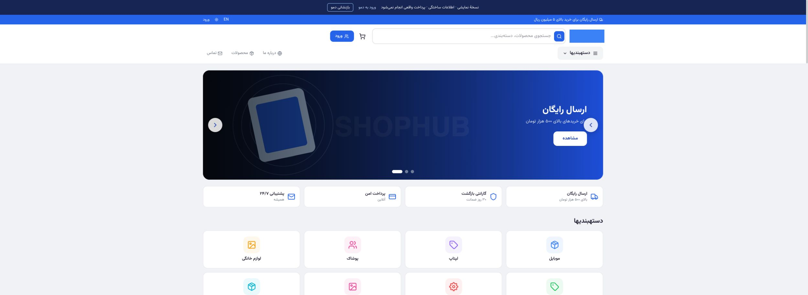
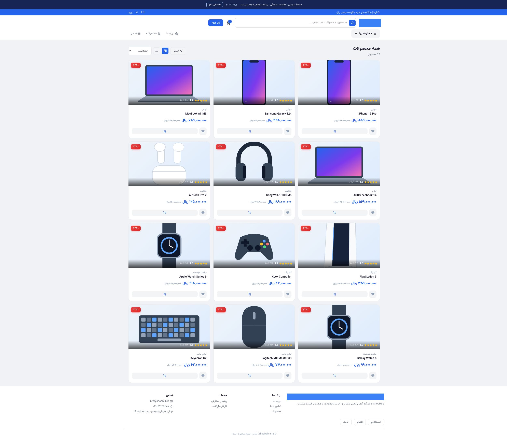
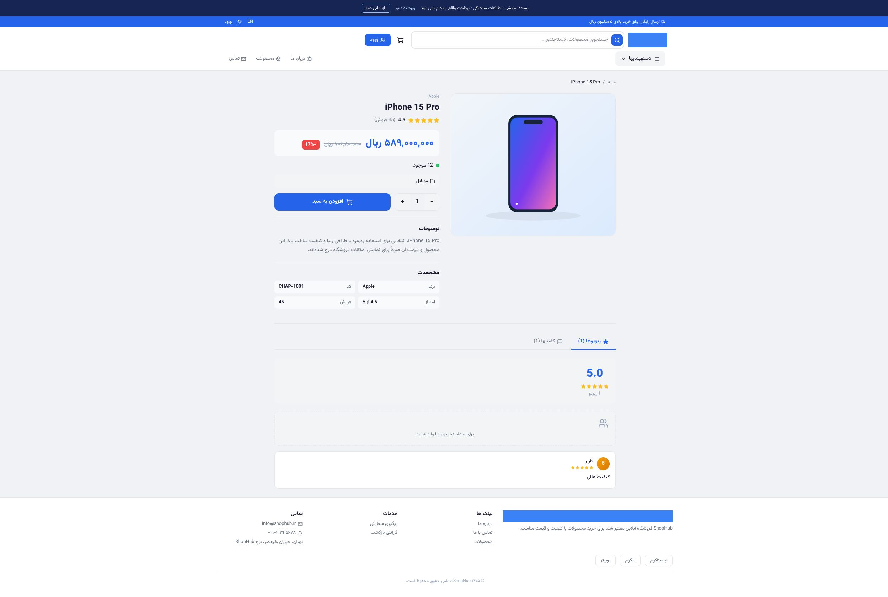
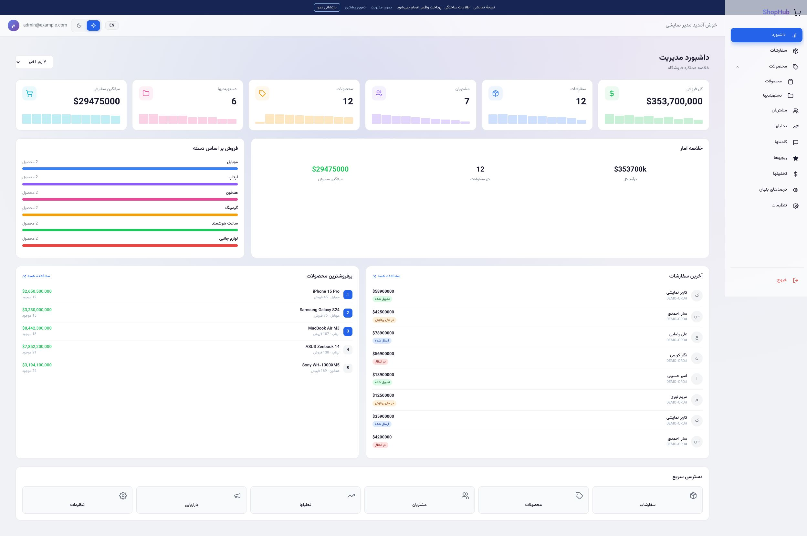

# Chap Ecommerce · ShopHub

A Persian-first ecommerce storefront and admin dashboard built with **Next.js 15, React 19 and TypeScript**, with a separate **NestJS + Prisma + PostgreSQL** backend.

**[Live demo](https://chap-ecommerce.vercel.app)** · **[Admin login](https://chap-ecommerce.vercel.app/auth/login)**

## Try the demo

| Account | Email | Password |
| --- | --- | --- |
| Admin | `admin@example.com` | `Demo123!` |
| Customer | `customer@example.com` | `Demo123!` |

Use **دموی مدیریت** or **دموی مشتری** in the top demo bar for one-click access, or use the account buttons on the login screen and press **ورود**. Explore the catalog, add products to the cart, try checkout with the customer account, or manage products and orders with the admin account.

The public deployment is an **interactive frontend demo**. Its 12 products, six categories, fictional customers, 12 orders and reviews are seeded in the browser. Changes persist in that browser only; use **بازنشانی دمو** to restore the original data. There are no real payments, messages or database writes. Demo credentials are public and are not production authentication. Avoid entering real personal information.

## Features

- RTL storefront with search, categories, product details, discounts and cart.
- Customer area with orders, wishlist, reviews and delivery locations.
- Admin dashboard with products, categories, orders, customers, analytics and marketing screens.
- Persian/English interface and light/dark themes.
- Browser-isolated demo data and local SVG product illustrations, with no external image dependency.

## Screenshots

Captured from the deployed demo (fictional data and local product illustrations).






## Run locally

Use Node.js 24 and pnpm 9.15.4.

```bash
corepack enable
pnpm install --frozen-lockfile
pnpm build:shared
cp apps/web/.env.example apps/web/.env.local
pnpm dev:web
```

Open `http://localhost:4200`. The web example enables demo mode, so no database, API server or secrets are required.

```bash
pnpm test:web
pnpm --filter @ecommerce/web typecheck
pnpm build:shared
pnpm build:web
```

## Repository structure

```text
apps/web/       Next.js storefront, customer area and admin UI
apps/api/       NestJS REST API (separate backend mode)
packages/db/    Prisma schema and PostgreSQL seed
packages/shared/ Shared TypeScript contracts
```

The demo adapter is `apps/web/src/app/lib/demo.ts`; the existing API is selected when `NEXT_PUBLIC_DEMO_MODE` is disabled. The demo does not exercise the NestJS API. Backend mode uses the root `.env.example`, PostgreSQL and the API server; the original backend's authentication and authorization need a separate production-hardening pass before real customer use.

## Vercel deployment and updates

The GitHub repository is connected to Vercel. Push to `main` to deploy updates automatically.

- Root directory: `apps/web`
- Framework: Next.js; Node.js: 24.x
- Install: `cd ../.. && pnpm install --frozen-lockfile`
- Build: `cd ../.. && pnpm build:shared && pnpm build:web`
- Production environment: `NEXT_PUBLIC_DEMO_MODE=true`
- For backend mode: set `NEXT_PUBLIC_DEMO_MODE=false` and `NEXT_PUBLIC_API_URL` to your deployed API, then rebuild. Never put secrets in `NEXT_PUBLIC_*` variables.

```bash
git add <changed-files>
git commit -m "Describe the update"
git push origin main
```

## Author

[Moein Parvizi](https://github.com/moeinparvizi) · Frontend Developer
